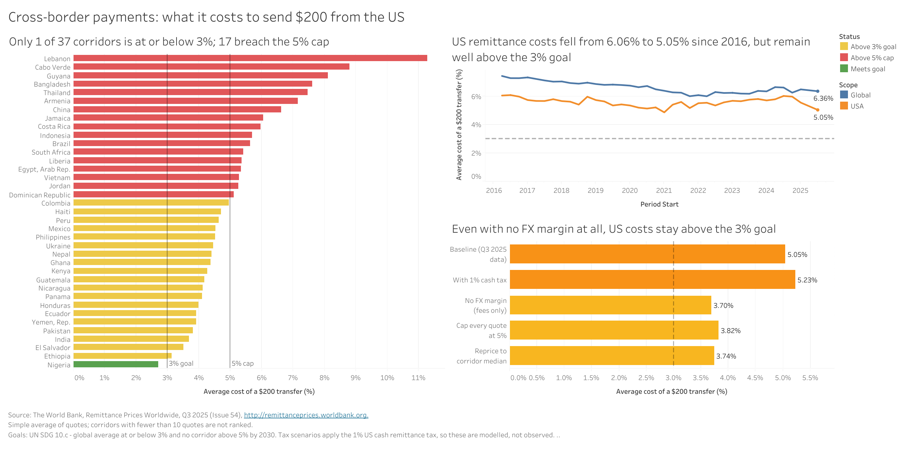

# Cross-border payments cost model

What does it cost to send $200 from the US, and how far is that from the 3% goal?



**[Live dashboard (Tableau Public)](https://public.tableau.com/views/Cross-BorderPaymentsCostModel/Dashboard)** | **[Memo](docs/memo.md)** | Excel model: `excel/cross_border_payments_model.xlsx`

## Headline findings
- Sending $200 from the US costs **5.05%** on average ($10.09), against a G20 / UN SDG 10.c goal of 3%. The global average is 6.36%.
- Of 37 ranked US-outbound corridors, **17 are above the 5% cap** and only one (Nigeria, 2.72%) is under 3%.
- Fees are 3.70 pp of the 5.05%, so even with no FX margin the average would be 3.70%.
- The 1% US cash remittance tax (from 1 January 2026) is modelled as +1 pp on cash-funded quotes. It lifts the US average to 5.23% and pushes two more corridors (Haiti, Colombia) over the cap.

## What is in this repo
```
src/       clean.py, analyze.py, regulation.py, scenarios.py, export_tableau.py
tests/     32 pytest tests
excel/     cross_border_payments_model.xlsx (live calculator, corridors, scenarios, targets)
docs/      memo.md, dashboard.png
data/      processed tables and Tableau-ready CSVs (raw data not included)
```

## Run it yourself
1. Download the dataset from the World Bank: Remittance Prices Worldwide, http://remittanceprices.worldbank.org, and save it as `data/raw/rpw_dataset_2011_2025_q3.xlsx`. I do not redistribute it.
2. Then:
```
python -m venv .venv
source .venv/bin/activate
pip install -r requirements.txt
python src/clean.py data/raw/rpw_dataset_2011_2025_q3.xlsx data/processed
python src/analyze.py data/processed
python src/scenarios.py data/processed
python src/export_tableau.py
python -m pytest -q
```

## Method
- Total cost % = fee % + FX margin %, where FX margin = (interbank rate - offered rate) / interbank rate.
- Averages are simple (unweighted), following the World Bank. This reproduces its published 6.36% global average.
- Corridors with fewer than 10 quotes are not ranked.
- Negative-cost quotes are kept and flagged. Without them the US average is 5.15%.
- Undisclosed FX margins are treated as unknown, not free.

## Limits
- Quotes are advertised prices, not completed transactions.
- The data predates the 1% tax, so tax results are **modelled, not observed**. IRS proposed regulations were published in April 2026, so check for final rules.
- No volume weighting.
- The 2025 data has gaps between quarters.

## Data and attribution
The World Bank, Remittance Prices Worldwide, available at http://remittanceprices.worldbank.org

## AI use disclosure
This project was built in assistance with Claude (Anthropic) as a coding assistant. I ran the code, checked the outputs against the source data and can explain every step.